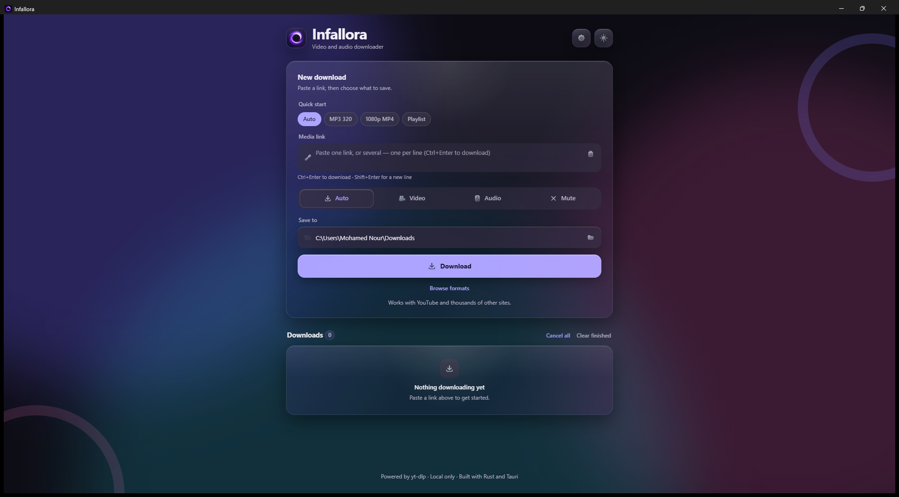
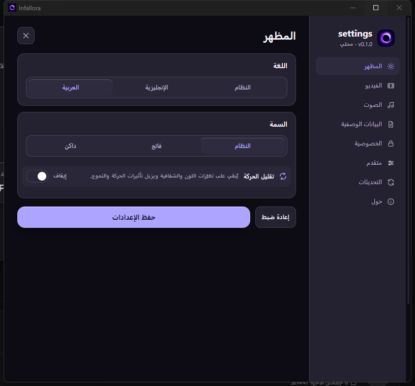

<p align="center">
  
</p>

<h1 align="center">Infallora</h1>

<p align="center">
  A fast, private media downloader for Windows and Linux. Liquid-glass UI, playlists,
  full format control, nine languages, and self-updating engines.
</p>

<p align="center">
  <a href="https://github.com/monourar/infallora/releases/latest"></a>
  <a href="https://github.com/monourar/infallora/releases/latest"></a>
  
  
  <a href="LICENSE"></a>
</p>

---

## Download

Get the latest installer from **[Releases](https://github.com/monourar/infallora/releases/latest)**:

- **Windows** — `Infallora_x.x.x_x64-setup.exe`
- **Linux** — `Infallora_x.x.x_amd64.AppImage` or `.deb`

If Windows SmartScreen warns, click **More info → Run anyway**. The installer is unsigned, but all update manifests are signed and verified automatically.

> Requires WebView2 on Windows (preinstalled on most systems).

---

## Screenshots






---

## Features

- **Thousands of sites** via [yt-dlp](https://github.com/yt-dlp/yt-dlp)
- **Quality up to 8K** — or smallest file; container, codec, bitrate and audio format control
- **Multiple links at once** — paste several URLs, one per line
- **Playlists and YouTube search** — browse with thumbnails, multi-select, one row per video
- **Subtitles, metadata and thumbnails** — plus embedded audio tracks
- **Liquid-glass UI** — light/dark, seven color themes, reduced motion, dynamic download island
- **Nine languages** — English, العربية, Français, Español, Deutsch, Türkçe, Português, Русский, 中文, with RTL for Arabic
- **System tray** — closing hides to tray; downloads keep running
- **Notifications** — native toast on completion, plus an update popup with auto-install toggle
- **Persistent history** — survives restarts; Open file / Open folder on each row
- **Self-updating** — app and yt-dlp update automatically
- **Auto-update engines** — yt-dlp refreshed on startup
- **Local only** — no account, telemetry, upload or cloud

---

## Quick start

1. Paste a video URL, playlist URL, or search term into **Media link**.
2. Pick a preset: **Auto**, **MP3 320**, **1080p MP4**, or **Playlist**.
3. Choose a folder and click **Download** (`Ctrl+Enter` also works).

For playlists and search results, tick the videos you want — selected rows highlight — then press **Download (n)**. Quality and container can be chosen inside the panel.

For private videos, export `cookies.txt` from your signed-in browser and place it next to `Infallora.exe` (auto-detected), or pick it in **Settings → advanced → cookies file**.

> Infallora only accesses content your browser session can already reach. It cannot bypass paywalls or region locks.

---

## Privacy

Everything runs on your PC. Files go only to the folder you choose. Preferences and history stay in `%APPDATA%\Infallora\`. There is no account, analytics, or upload path.

Infallora only accesses content your browser session can already reach. It cannot bypass paywalls or region locks.

---

## FAQ

**Why does a video fail with 403?**
YouTube's CDN sometimes rejects a stream token. Infallora retries up to three times. If it still fails, the video is usually account-restricted — add a cookies file.

**Where did the window go?**
Closing hides Infallora to the system tray. Click the tray icon or choose **Show** to restore; **Quit** exits.

**Do I need to update yt-dlp myself?**
No — it updates automatically on startup. Toggle it in **Settings → updates → engines**.

**Does it work offline?**
No. Downloads and update checks need a connection; your files and settings stay local.

---

## Build from source

```powershell
git clone https://github.com/monourar/infallora.git
cd infallora
npm install --no-save @tauri-apps/cli
# download yt-dlp.exe, ffmpeg.exe and ffprobe.exe into the repo root
npx tauri build
```

Signed builds need `TAURI_SIGNING_PRIVATE_KEY` and `TAURI_SIGNING_PRIVATE_KEY_PASSWORD` secrets (see [RELEASING.md](RELEASING.md)). Without them the app builds but produces no update signature.

---

## License

Infallora's source is [MIT licensed](LICENSE). Release bundles include third-party engines with their own licenses — see [NOTICE.md](NOTICE.md) and the bundled `LICENSE-GPLv3.txt`.

<p align="center">
  <sub>Made with Rust and Tauri · Icons by <a href="https://thesvg.org">theSVG</a></sub>
</p>
