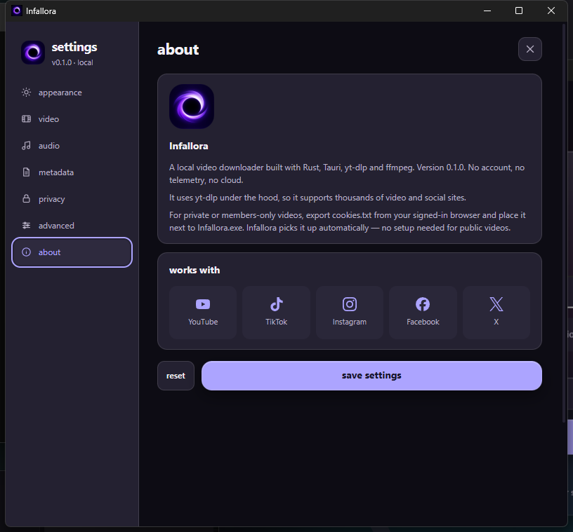

<p align="center">
  
</p>

<h1 align="center">Infallora</h1>

<p align="center">
  A fast, private media downloader for Windows. Liquid-glass UI, playlist support,
  full format control, six languages, and self-updating engines.
</p>

<p align="center">
  
  
  
  
  
  
  
  
  
</p>

<p align="center">
  <a href="https://github.com/monourar/infallora/releases/latest"></a>
  <a href="https://github.com/monourar/infallora/releases"></a>
  
  
  <a href="LICENSE"></a>
</p>

---

## Contents

- [Download](#download)
- [Screenshots](#screenshots)
- [Features](#features)
- [Quick start](#quick-start)
- [Where things are stored](#where-things-are-stored)
- [Privacy](#privacy)
- [Build from source](#build-from-source)
- [Project layout](#project-layout)
- [FAQ](#faq)
- [Contributing](#contributing)
- [License](#license)

---

## Download

Get the latest installer from **[Releases](https://github.com/monourar/infallora/releases/latest)**.

1. Download `Infallora_x.x.x_x64-setup.exe`.
2. Run it. If Windows SmartScreen appears, click **More info → Run anyway** — the installer is unsigned (see [FAQ](#faq)).
3. Open Infallora and paste a link.

Updates are checked on startup, or manually in **Settings → updates**. The app and its yt-dlp engine both update themselves.

> Requires **Windows 10/11** with [WebView2](https://developer.microsoft.com/microsoft-edge/webview2/) (preinstalled on most systems).

---

## Screenshots

| Main window | Settings |
|:---:|:---:|
|  |  |

Arabic interface with automatic RTL layout:


---

## Features

**Downloading**

 Thousands of sites via [yt-dlp](https://github.com/yt-dlp/yt-dlp)
 Quality up to 8K/4K, down to *smallest file*

 Container (MP4/WebM/MKV), codec (H.264/AV1/VP9), bitrate and audio format control
- Playlist browsing with thumbnails, select all/none, one row per video
- Subtitles (10 language shortcuts + any ISO code), embedded metadata, thumbnail sidecars
- Automatic retry on transient HTTP 403 errors

**Experience**
- Liquid-glass interface with light/dark themes and reduced motion
- Dynamic Island-style download activity with long-press expand and queue peek
- Six languages — English, العربية, Français, Español, Deutsch, Türkçe — with RTL mirroring for Arabic
- System tray: closing the window hides to tray while downloads continue
- Native Windows notifications on completion or failure
- Persistent download history across restarts
- Separate **Open file** and **Open folder** actions on each download

**Maintenance**
- Signed self-updates via GitHub Releases
- Automatic yt-dlp updates on startup, plus an on-demand button
- `infallora://<url>` deep links for browser integration
- Automatic `cookies.txt` detection for private content
- No account, telemetry, upload or cloud — everything runs locally

---

## Quick start

1. Paste a video or playlist URL into **Media link**.
2. Pick a preset: **Auto**, **MP3 320**, **1080p MP4**, or **Playlist**.
3. Choose a folder and click **Download**.

Use **Browse formats** for per-format details before downloading.

### Playlists

Paste a playlist link and Infallora lists every entry with thumbnail and duration. Use **all** / **none** or tick individual videos, then press **Download** — only selected videos are queued.

### Private or members-only videos

Public videos need no setup. For restricted content:

1. Install the **Get cookies.txt LOCALLY** browser extension.
2. While signed in, export cookies as `cookies.txt`.
3. Place the file **next to `Infallora.exe`** (auto-detected), or select it in **Settings → advanced → cookies file**.

Infallora cannot bypass authentication — it only accesses content your browser session can already reach.

### Browser links

The installer registers the `infallora://` scheme. A link like this opens the app and fills the URL field automatically:

```
infallora://https://www.youtube.com/watch?v=dQw4w9WgXcQ
```

### Language

**Settings → appearance → language** offers *system* plus all six languages. The layout mirrors automatically in Arabic; *system* follows your Windows language.

---

## Where things are stored

| Item | Location |
|---|---|
| Preferences | `%APPDATA%\Infallora\settings.json` |
| Download history | `%APPDATA%\Infallora\downloads.json` |
| Cookies (auto-detected) | Next to `Infallora.exe`, or in your Downloads folder |
| Bundled engines | Install folder, under `_up_` (yt-dlp, ffmpeg, ffprobe) |

Deleting the two JSON files resets preferences and history. Downloaded media stays wherever you saved it.

---

## Privacy

Everything runs on your PC. Infallora drives the bundled yt-dlp and ffmpeg binaries, writes files only to your chosen folder, and stores preferences locally. There is no account, analytics, or upload path.

---

## Build from source

Requirements: Windows 10/11, [Rust](https://rustup.rs/), Node.js 20+, WebView2.

```powershell
git clone https://github.com/monourar/infallora.git
cd infallora
npm install --no-save @tauri-apps/cli
```

Download the engines into the repository root:

```powershell
curl.exe -L -o yt-dlp.exe https://github.com/yt-dlp/yt-dlp/releases/latest/download/yt-dlp.exe
curl.exe -L -o ffmpeg.zip https://www.gyan.dev/ffmpeg/builds/ffmpeg-release-essentials.zip
# extract ffmpeg.exe and ffprobe.exe from the zip into this folder
```

Build the signed installer:

```powershell
npx tauri build
```

Output: `src-tauri/target/release/bundle/nsis/`. Signing needs `TAURI_SIGNING_PRIVATE_KEY` and `TAURI_SIGNING_PRIVATE_KEY_PASSWORD` (see [RELEASING.md](RELEASING.md)); without them the app builds but no update signature is produced.

Quick debug build without bundling:

```powershell
cd src-tauri
cargo build
.\target\debug\infallora.exe
```

> No MSVC linker? Use the GNU toolchain:
> `cargo +stable-x86_64-pc-windows-gnu build --release`.

---

## Project layout

```
dist/            HTML, CSS and JS interface (i18n, updater, engine UI)
src-tauri/       Rust backend and Tauri configuration
  src/main.rs    downloads, settings, playlists, cookies, tray, deep links
  icons/         squircle app icon
  capabilities/  plugin permissions
docs/            README screenshots
RELEASING.md     signed release process
NOTICE.md        third-party license notice
```

Built with  **Rust** and  **Tauri**. The UI polls the backend for progress, keeping the implementation small. Cancelling stops yt-dlp and its child processes; transient 403 failures retry automatically.

---

## FAQ

 **Why does Windows warn about the installer?**
Infallora is not code-signed, so SmartScreen warns for any unsigned app. Verify you downloaded from this repository's Releases page, then click **More info → Run anyway**. The *update manifest* is signed, so future updates verify automatically.

**Where did the window go?**
Closing the window hides Infallora to the system tray — downloads keep running. Click the tray icon or choose **Show** from its menu to restore. Choose **Quit** to exit.

 **Why does a video fail with 403?**
YouTube's CDN sometimes rejects a stream token. Infallora retries up to three times with a short backoff. If it still fails, the video is usually account-restricted — add a cookies file.

**Do I need to update yt-dlp myself?**
No. It updates automatically on startup. You can also run **Settings → updates → engines → update yt-dlp** at any time. Change *update engines on startup* to *off* to disable this.

**Does it work offline?**
No. Downloads and update checks need a connection, but settings and files stay local.

**Can it bypass paywalls or region locks?**
No. It only accesses content your browser session can already access.

---

## Contributing

Issues and pull requests are welcome. For a new translation, add a language table to `dist/translations.js` and an option to the language selector in `dist/index.html` + `dist/settings.js`. Run `node --check` on changed JS before opening a PR.

---

## License

Infallora's source is [MIT licensed](LICENSE). Release bundles include third-party engines with their own licenses — see [NOTICE.md](NOTICE.md) and the bundled `LICENSE-GPLv3.txt`. Respect the terms of service of sites you use and the rights of creators.

---

## Links

| | |
|:---:|---|
|  | [Download](https://github.com/monourar/infallora/releases/latest) · [Report an issue](https://github.com/monourar/infallora/issues) · [Release process](RELEASING.md) · [Licensing notice](NOTICE.md) |
|  | Discord community — *coming soon* |
|  | Telegram channel — *coming soon* |

<p align="center">
  <sub>Made with  Rust and  Tauri · Icons by <a href="https://thesvg.org">theSVG</a></sub>
</p>
